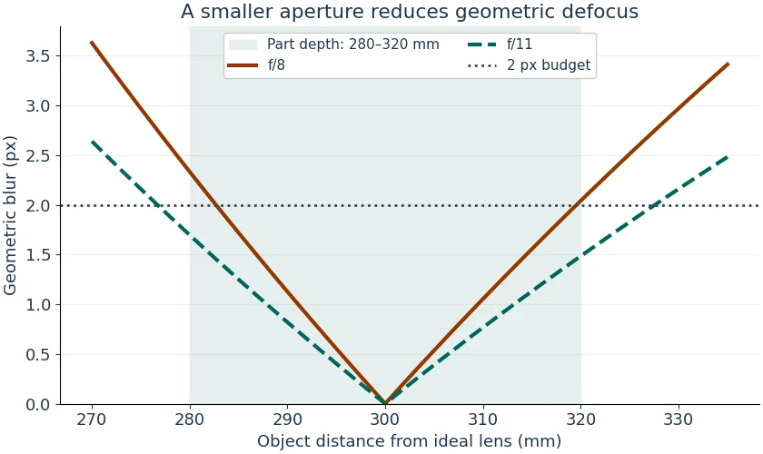

# Camera Depth of Field Lab

Use a thin lens model to check whether the front and back of a part fit a geometric blur budget. The full lesson is at [WIFA Robotics](https://wifarobotics.com/learn/camera-depth-of-field/).

## Get started

1. Install [Python 3.10 or newer](https://www.python.org/downloads/).
2. On GitHub choose **Code → Download ZIP**. Extract it and open a terminal in the folder with `dof.py`.
3. Use the commands below. On Windows you can use `py -3` in place of `python3`. The examples and tests need no external packages.

```sh
python3 --version
python3 dof.py examples/f8.json
python3 dof.py examples/f11.json
python3 dof.py examples/one-pixel.json
python3 -m unittest discover -s tests -v
```

| Example | Blur budget | Front / back blur | Result |
| :-- | --: | --: | :-- |
| f/8 | 2 px | 2.33 / 2.04 px | Outside |
| f/11 | 2 px | 1.70 / 1.48 px | Inside |
| f/11, finer target | 1 px | 1.70 / 1.48 px | Outside |

The model measures focus and target distance from an ideal lens plane. Use millimetres for those distances and focal length, micrometres for the physical sensor pixel pitch, and pixels for the budget. The JSON target range is `[near, far]`. A `null` far limit with `geometrically_unbounded_far` true means no finite far cutoff in the geometry. A `null` near limit with `near_limited_by_model_domain` true means the algebraic bound fell at or below the focal length. Neither flag means that an actual camera can resolve the required detail.

If Python cannot find the file, check your terminal's working folder. If the CLI reports an input error, check that all required fields are present, distances exceed focal length and the near target comes first. Copy an example before changing the f-number or blur budget.



The two WebP figures are generated from the example inputs. To regenerate them, install Matplotlib and Pillow in a virtual environment and run `python3 diagrams/render.py`. The simulation does not model diffraction, aberrations, lens focus breathing, lighting, motion, or the detection algorithm. A geometric pass is a planning result. Verify contrast on real parts across the required range before choosing a production setting.
